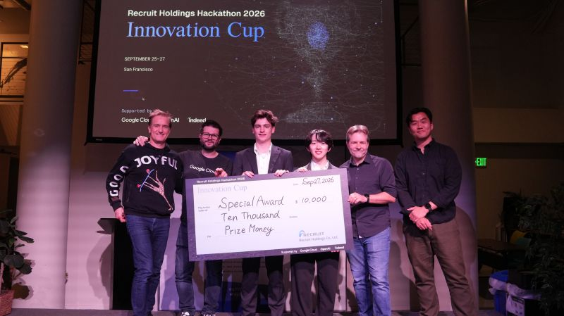
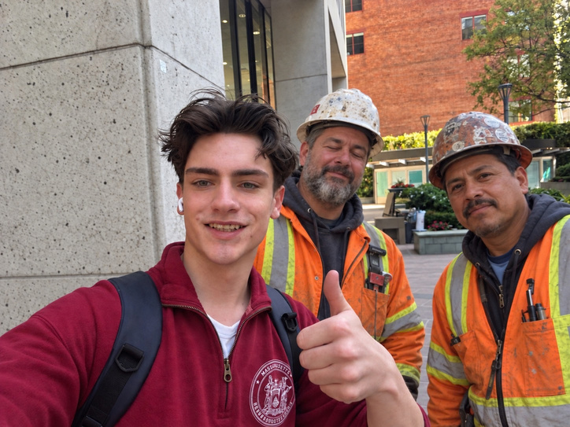
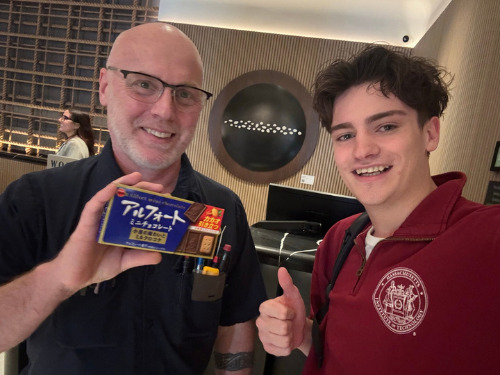
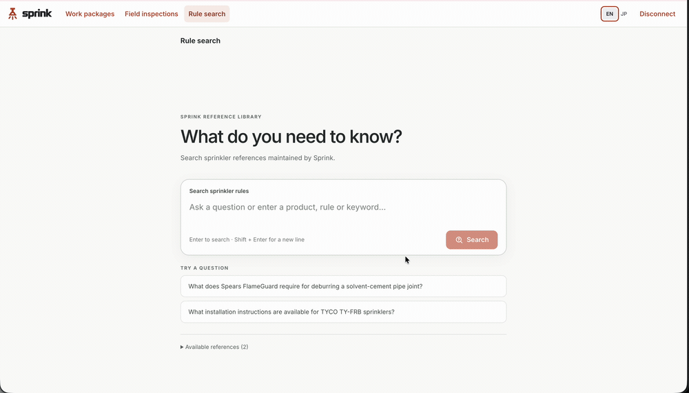
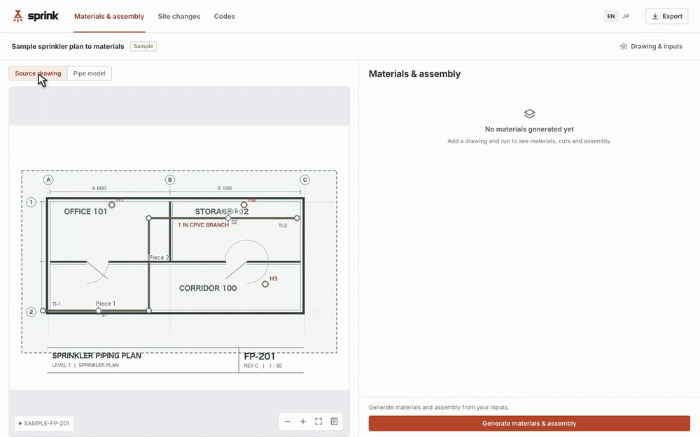
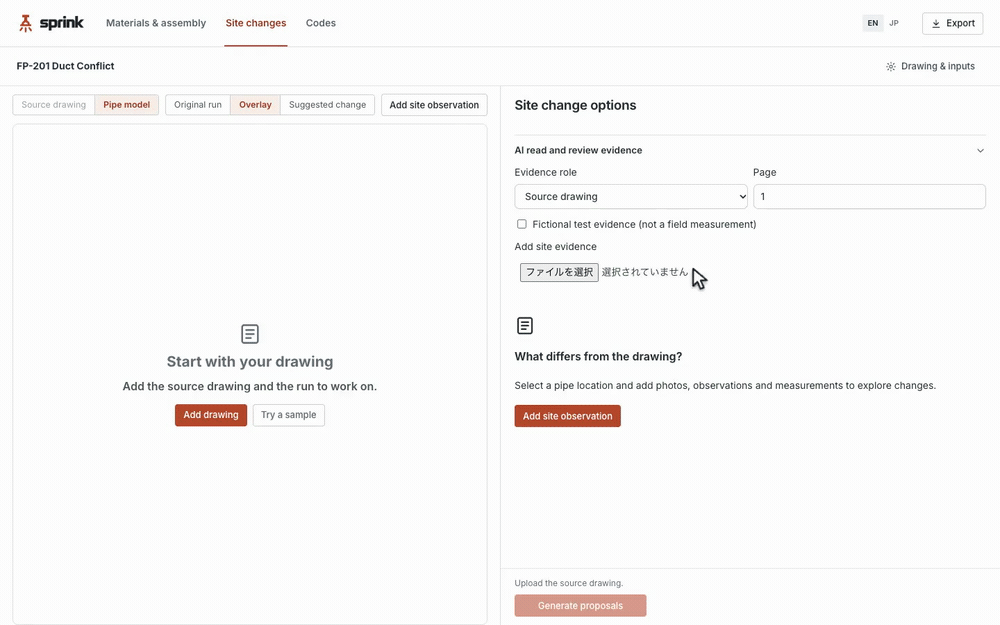
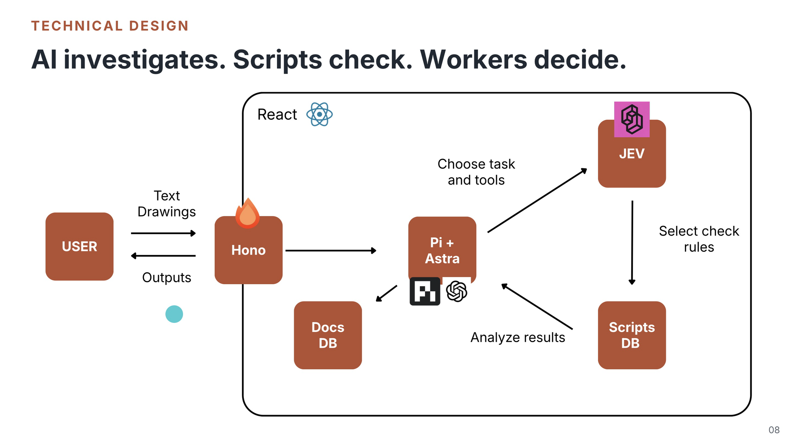
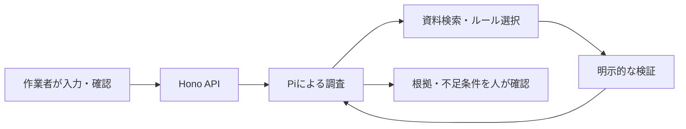

<p align="right"><a href="README.md">English</a> | <strong>日本語</strong></p>

# SprinkMate

### 🏆 2位 · チーム特別賞10,000米ドル

**Recruit Holdings / Indeed Innovation Cup · サンフランシスコ · 2026年9月25〜27日**

**Jake Smith・Yu Yoshimuta — Team KumoPath**

Yuと私は48時間でSprinkを開発し、チームで**10,000米ドルの特別賞**を受賞しました。施工者、初めて料金を払ってくれたチーム、審査員から学んだことをもとに、その後も開発を続けています。



*48時間の開発後、サンフランシスコの授賞式でのYuと私。*

---

**ボストンのスプリンクラー施工者向けの資料検索と現場作業ツール。**

原典を読み、版とページを確認し、図面から作業を準備して、現場での変更を検討するプロトタイプです。現在はマサチューセッツ州ボストンの商業・住宅工事を対象に開発しています。

[Innovation CupのSprink](https://github.com/my-name-is-yu/InnovationCup)を引き継いでいます。ボストン向けの開発では、参照ライブラリの画面、文書を限定した検索、確認済みの州資料パッケージ、資料台帳を追加しました。

[**写真付きの全編ストーリー**](docs/PROJECT_STORY.ja.md) · [進捗と検証記録](PROGRESS.md) · [起動する](#run-locally) · [資料調査](sprink/docs/boston-source-findings.md) · [開発設定](sprink/README.md)

## Sprinkが生まれた背景

**Recruit Holdings Innovation Cup 2026**に、Yu Yoshimutaと**KumoPath**というチームで参加しました。私は大阪の立命館大学、Yuは東京の慶應義塾大学の学生でした。スプリンクラー施工や設備管理の仕事について話を聞き、そこで教わった仕事に合わせて試作を始めました。

<table>
<tr>
<td width="50%"></td>
<td width="50%"></td>
</tr>
<tr>
<td><sub><b>JackとJoseと。</b> 必要な要件の探し方と、現場変更への対応を聞きました。</sub></td>
<td><sub><b>Kareemに会って。</b> Hyatt Regencyの設備管理の実務について学びました。</sub></td>
</tr>
</table>

聞き取りから、原典を探す、確認済みの図面から作業を準備する、障害物などの現場変更を検討する、という3つを中心にしました。施工者が自分で根拠と確認結果を読み、次の行動を決められるようにしたいと考えました。

コンペ中には**初めての有料利用チーム**もできました。**1人の顧客が月20ドルを3人分、初月60ドル**で購入し、日曜の朝にZoomで一緒に試しました。その日の後半には、仕事で役立ったと連絡をもらいました。継続利用や時間短縮はまだ測定していませんが、次の検証につながる結果でした。これはピッチ時点の実績で、現在の契約数ではありません。

SprinkMateでは、その開発をボストンの仕事に向けて続けています。当時の操作に加えて、後から資料ライブラリと調査内容を追加しました。

## 進捗の概要

進捗報告の更新日は**2026年11月13日**です。以下の実装と調査の成果は10月7日にコミットしたもので、資料自体の日付は台帳に記載しています。

| 項目 | 成果 | 根拠 |
|---|---|---|
| 参照ライブラリ | 閲覧・絞り込み、条文・例外・版・ページの確認、選択文書内の検索。 | [ライブラリのコミット](https://github.com/Jsmitty78/SprinkMate/commit/a32ded748227c2cba7aa10d762abdf878560f4fa) |
| 確認済み資料 | **3パッケージ・8節**。消防規定の採用条項、第35章の修正、住宅R313のスプリンクラー修正。 | [取り込み用資料](sprink/reference-sources/boston-public) |
| ボストンの調査 | **参照先16件、政府PDF9件・合計243ページ**をローカルに収集。BFDガイドの記録も保存。 | [資料台帳](sprink/reference-catalog/boston-ma.json) · [取得記録](sprink/reference-catalog/boston-downloads-2026-10-07.json) |
| 取り込みの信頼性 | フォルダー入力、事前検証、変更しない文書ID、不正な一括入力のロールバック。 | [取り込み処理](sprink/scripts/import-sources.ts) · [テスト](sprink/apps/server/test/source-import-cli.test.ts) |
| ソフトウェアの検証 | 基盤の報告では**340件成功**。資料拡充のコミットでも型検査・テスト・ビルド成功。 | [検証記録](sprink/docs/sprinkmate-verification.md) · [当時のCI](https://github.com/Jsmitty78/SprinkMate/actions/runs/37578338118) |

参照ライブラリの閲覧はAIキーなしで動作します。自然言語検索にはJEVキーと利用許可のある原文が必要です。NFPA書籍全文は含まず、収集・登録した資料数と、実際に取り込んだ本文の範囲は異なります。現場での精度はまだ確立していません。

<a id="workflows"></a>
## 操作を見る

以下はInnovation Cupから引き継いだ操作の映像です。ボストン向けの追加とコミットは[進捗報告](PROGRESS.md)で区別しています。

**[デモ動画を見る](https://drive.google.com/file/d/19NsJLkqckJ90Wz9RkVEdC_G9nGbWRCAZ/view?usp=sharing)**

<a id="find-the-original"></a>
## 原典を探す

製品や施工要件を質問し、登録済みライブラリの該当する原文やPDFページを開きます。文書とページの文脈を確認できます。



<a id="prepare-the-work"></a>
## 作業を準備する

図面の縮尺、寸法、入力を確認し、材料一覧、必要条件がそろった場合の切断長、出典付きの組立手順を準備します。不足条件も表示したまま、内容を確認してPDF・CSVへ出力できます。



<a id="handle-a-site-change"></a>
## 現場変更に対応する

障害物と配管周辺の実測スペースを記録します。経路案、材料・長さの変化、実施したチェック、未解決の問いを比較し、作業者が経路と更新内容を確認します。



*提出動画から抜粋したGIFです。材料準備・現場変更の動画は早送りで、処理時間の実測を示すものではありません。図面もデモ用の例です。*

## 技術構成

**AIが調べ、スクリプトが確認し、作業者が決める。**



| 要素 | 担当 |
|---|---|
| React + Vite | 図面・資料の表示、入力確認、提案比較、出力。 |
| Hono + Node.js | 認証付きAPI、アップロード、作業パッケージのリビジョン、PDF・CSV。 |
| Pi + GPT-6 Astra | 保存した根拠の調査、ツール選択、不足情報の要求、Pi標準ループによる結果説明。 |
| JEV | カタログから検証ルールを選択し、参照資料の検索も支援。 |
| 検証スクリプト | 適用条件、入力、対象領域を明示的に確認し、結果と不足項目を返す。 |
| SQLite + ローカルファイル | パッケージ、確定情報、資料メタデータ、観察、成果物を保存。 |

図のDocs DBは登録した資料ライブラリ、Scripts DBはバージョン管理したルールカタログと実行スクリプトです。別のデータベースサービスではありません。Reactはブラウザー、APIとエージェントはサーバーで動作します。

根拠を読む→JEVがチェックを選ぶ→スクリプトが実行する→エージェントが結果から次の手順を考える、という流れです。人による確認と経路採用は明示的に保存し、入力変更で古い出力を無効にします。



<a id="run-locally"></a>
## ローカルで起動する

Node **22.19.0**とpnpm **10.17.1**を使用します。SQLiteのネイティブ依存関係は、実行時と同じNodeでインストールしてください。

```sh
git clone https://github.com/Jsmitty78/SprinkMate.git
cd SprinkMate/sprink
pnpm install --frozen-lockfile
cp .env.example .env.local
pnpm sources:import reference-sources/boston-public --check
pnpm sources:import reference-sources/boston-public
pnpm build
pnpm start
```

`http://127.0.0.1:4310/codes`を開き、ローカルの`.data/access-token`にある値を入力します。閲覧にAIキーは不要です。JEV検索には`.env.local`の`TYPESAFE_API_KEY`、図面・現場エージェントにはさらに`OPENAI_API_KEY`が必要です。キーやトークンをGit、URL、スクリーンショットに載せないでください。[資料の準備・取り込み・評価の詳細](sprink/docs/boston-setup.md)を参照できます。

```sh
pnpm typecheck
pnpm test
pnpm build
```

## プロトタイプの範囲

Sprinkは人が確認するための作業情報を準備します。根拠の不足は`unknown`で残し、エージェントの完了やチェック成功を法規適合や施工承認とは扱いません。対象は[実装したルール](sprink/docs/rule-inventory.md)と入力の範囲に限られ、動画だけで測定精度や実際の施工結果を確認したことにはなりません。

[開発設定](sprink/README.md) · [エージェントの処理](sprink/packages/workflow/README.md)
