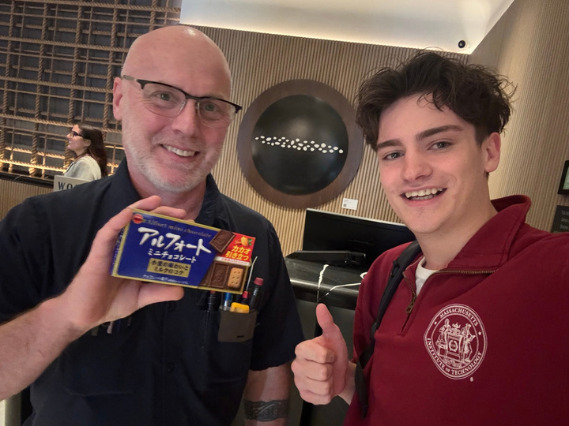
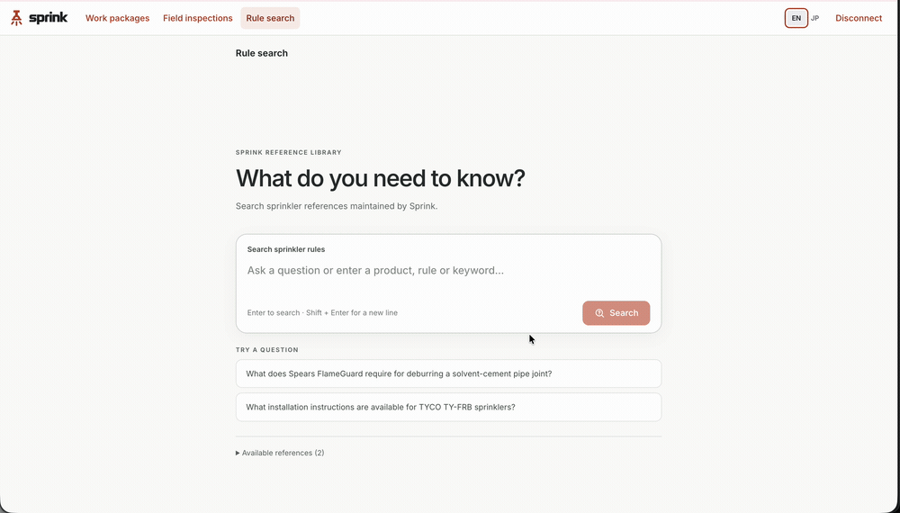
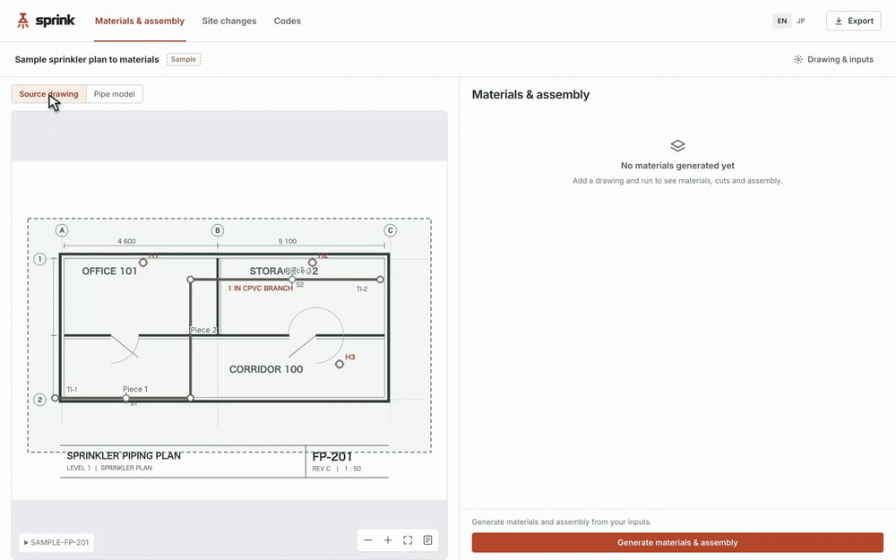
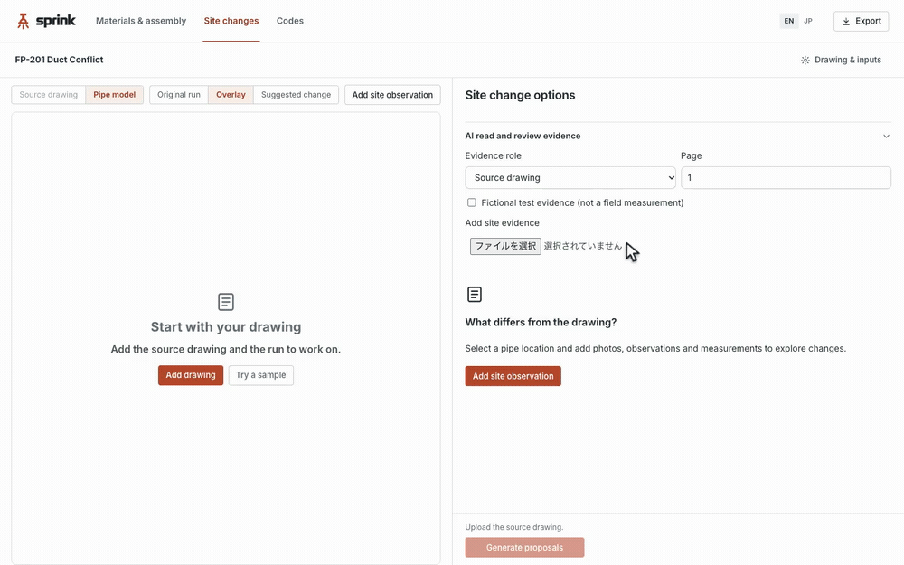
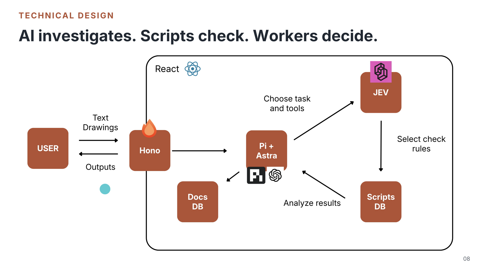

# SprinkMate

**Sprinkler reference search and field-work tools for Boston.**

SprinkMate is a working prototype for fire sprinkler fitters: read the original reference, check its edition and page, prepare work from drawings, and review changes found on site. Development is focused on commercial and residential work in Boston, Massachusetts.

Built on the [Innovation Cup 2026 Sprink project](https://github.com/my-name-is-yu/InnovationCup), with its app and Git history preserved. The Boston work adds a reference-library interface, document-specific search, reviewed state source packages and a source register.

[**Project progress and evidence**](PROGRESS.md) · [Run locally](sprink/docs/boston-setup.md) · [Source research](sprink/docs/boston-source-findings.md) · [Development setup](sprink/README.md)

## The story behind Sprink

I built Sprink with **Yu Yoshimuta** for the **Recruit Holdings Innovation Cup 2026**, as team **KumoPath**. I was studying at Ritsumeikan University in Osaka, and Yu was at Keio University in Tokyo. We started by speaking to people doing sprinkler installation and building maintenance, then built the prototype around the work they described.

<table>
<tr>
<td width="50%"></td>
<td width="50%"></td>
</tr>
<tr>
<td><b>With Jack and Jose.</b> Talking with sprinkler fitters in the San Francisco area about finding the right requirements and handling changes on site.</td>
<td><b>Meeting Kareem.</b> Learning about the practical needs of hotel maintenance from the Hyatt Regency chief maintenance engineer.</td>
</tr>
</table>

Those conversations shaped three parts of the product: find the original source, prepare the work from a confirmed drawing, and review a change when something on site gets in the way. We wanted the fitter to be able to see the source, understand the checks and decide what to do next.

Our competition deck also recorded the **first paying crew: one customer purchasing three $20 monthly subscriptions, for $60 in the first month**. After a Sunday-morning Zoom test, the team received feedback that the tool had helped during a job later that day. It was an encouraging first result, with repeat use and time savings still to measure. These are results from the competition pitch, not a claim about current subscriptions.

SprinkMate continues that work with a focus on Boston. The original workflows are preserved below, alongside the reference-library and source-research work added afterwards.

**[Read the full project story →](docs/PROJECT_STORY.md)**

## Progress at a glance

Progress report updated **November 13, 2026**. Implementation and source-research milestones below were committed on October 7; source dates remain explicit in the register.

| Area | Delivered | Evidence |
| --- | --- | --- |
| Reference library | Browse and filter sources; read clauses, exceptions, editions and page references; restrict a search to selected documents. | [Boston library commit](https://github.com/Jsmitty78/SprinkMate/commit/a32ded748227c2cba7aa10d762abdf878560f4fa) |
| Reviewed source packages | **3 packages, 8 indexed sections**: the fire-code adoption clause, Chapter 35 amendments and residential R313 sprinkler amendments. | [Importable packages](sprink/reference-sources/boston-public) |
| Boston research | **16 reference entries**; **9 government PDFs totaling 243 pages** acquired locally, plus a BFD guide snapshot. | [Source register](sprink/reference-catalog/boston-ma.json) · [Download manifest](sprink/reference-catalog/boston-downloads-2026-10-07.json) |
| Import reliability | Folder imports, validation before import, immutable document IDs and rollback of an invalid batch. | [Importer](sprink/scripts/import-sources.ts) · [Import tests](sprink/apps/server/test/source-import-cli.test.ts) |
| Software verification | Foundation report records **340 passing tests**; typecheck, tests and build also passed for the source-expansion commit. | [Verification record](sprink/docs/sprinkmate-verification.md) · [CI run](https://github.com/Jsmitty78/SprinkMate/actions/runs/37578338118) |

The reference library works locally without an AI key. Natural-language retrieval needs a JEV key and authorized source content. Full NFPA books are not loaded, source coverage is partial, and field accuracy has not yet been established. Downloaded pages and registered links are counted separately from imported text.

## See the workflows

The demo and recordings below show the inherited Innovation Cup workflows; the [progress report](PROGRESS.md) identifies the Boston additions and their commits.

**[Watch the demo video](https://drive.google.com/file/d/19NsJLkqckJ90Wz9RkVEdC_G9nGbWRCAZ/view?usp=sharing)**

## Find the original

Ask a question about a sprinkler product or installation requirement. Sprink searches its registered reference library and opens the relevant original passage or PDF page, with its document and page context available for review.

## Prepare the work

Start from a drawing and confirm the scale, dimensions and inputs. Sprink prepares a materials list, cut-length information where the required inputs are known, and assembly steps linked to their references. Missing conditions stay visible alongside the result. Review the package and export PDF/CSV outputs.

## Handle a site change

Record an obstruction and the measured space around the affected pipe. Sprink generates route proposals, compares material and length changes, and shows the checks and unresolved questions. The worker chooses a route and reviews the revised package.

*These GIFs are excerpts from the submission recordings. The materials and site-change clips are sped up; they do not show measured response times. The drawing examples are demonstration scenarios.*

## Technical design

**AI investigates. Scripts check. Workers decide.**

| Component | Responsibility |
| --- | --- |
| React + Vite | Drawing and source views, input confirmation, proposal comparison and exports. |
| Hono + Node.js | Authenticated API, uploads, work-package revisions and PDF/CSV delivery. |
| Pi + GPT-6 Astra | Investigate saved evidence, choose tools, request missing information and explain results using Pi's standard agent loop. |
| JEV | Select verification rules from a catalog; also support reference retrieval. |
| Verification scripts | Run explicit applicability, input and domain checks; return detailed results and missing inputs to the agent. |
| SQLite + local files | Persist work packages, confirmed facts, source metadata, observations and artifacts. |

The slide's **Docs DB** represents the registered source library. **Scripts DB** represents the versioned rule catalog and executable scripts in the codebase, rather than a separate database service. React is the browser interface; the API and agent workflow run on the server.

The agent reads evidence → JEV selects a check → its script runs → the agent inspects the result and decides the next step. Human confirmation and route adoption are explicit saved actions. Changes to inputs invalidate outdated outputs.

## Prototype scope

Sprink produces reviewable work information. Missing evidence remains `unknown`, and a completed agent run or passing check does not establish full code compliance or construction approval. Coverage is limited to the implemented rules and supported inputs; see the [rule inventory](sprink/docs/rule-inventory.md). Field measurement accuracy and real-world installation outcomes are not established by the demo recordings.

[Local setup and development](sprink/README.md) · [Agent workflow](sprink/packages/workflow/README.md)
