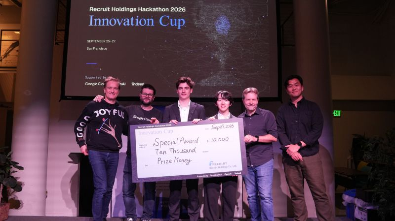
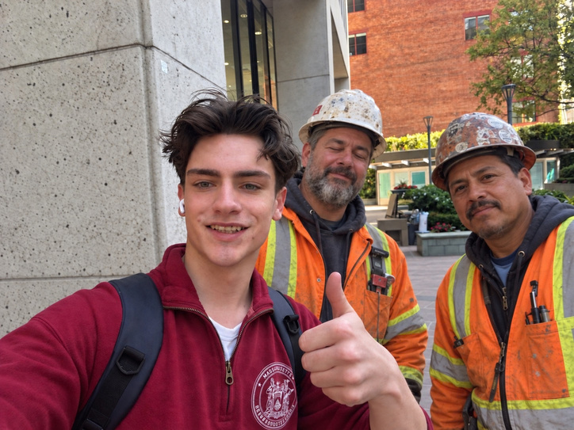
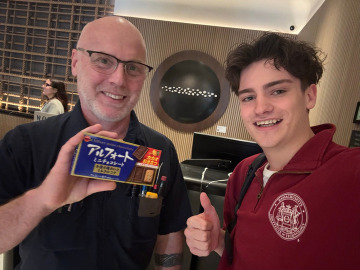
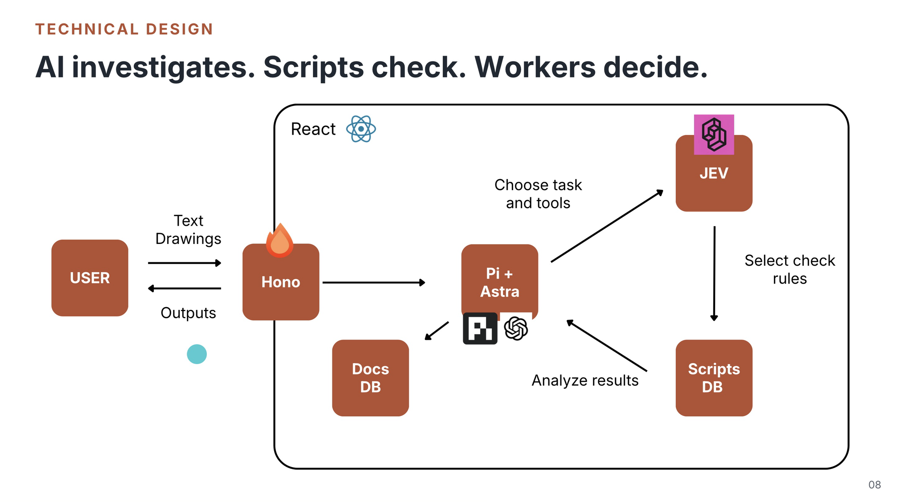

<a href="PROJECT_STORY.md">English</a> | <strong>日本語</strong>

# Sprinkをつくるまで：現場で出会った人たち

### 🏆 2位 · チーム特別賞10,000米ドル

**Recruit Holdings / Indeed Innovation Cup · サンフランシスコ · 2026年9月25〜27日**

**Jake Smith・Yu Yoshimuta — Team KumoPath**

Yuと私は48時間でSprinkを開発し、チームで**10,000米ドルの特別賞**を受賞しました。その後も、施工者への聞き取り、初めて料金を払って使ってくれたチーム、イベントでの助言をもとに開発を続けています。

*48時間の開発を終えた、サンフランシスコの授賞式でのYuと私。*

---

**Recruit Holdings Innovation Cup 2026**に、Yu Yoshimutaと**KumoPath**というチームで参加しました。私は大阪の立命館大学2年生、Yuは東京の慶應義塾大学2年生でした。日本から来た二人で、スプリンクラーを施工する人たちのためのツールに取り組みました。

情報を探す時間を減らして、作業を進める時間を増やせないか。そのために何が必要なのかを知るため、まず現場の方に話を聞きました。

[プロトタイプの起動](../README.ja.md#run-locally) · [操作のデモ](../README.ja.md#workflows) · [ボストン向け開発の進捗](../PROGRESS.md)

## サンフランシスコで施工者に話を聞く

サンフランシスコ周辺で、スプリンクラー施工者のJackとJoseに会いました。作業に合う規定をどう探すか、現場の状況が変わったら何が起きるかを聞きました。

*インタビューでのJack、Joseとの写真。元のピッチデックに収録したものです。*

規定を見つけることは、課題の一部にすぎませんでした。答えは作業の内容、使う製品、目の前の条件によって変わります。障害物で配管経路を変えるなら、さらに確認が必要です。原典を見つけ、何が当てはまるかを考え、次の作業を準備するところまで支える必要がありました。

話を聞いて、方向性がはっきりしました。施工者が自分で読んで確認できるように原典を残し、その情報を図面、材料、現場の変更につなげたいと考えました。

## ホテルの設備管理から学ぶ

Hyatt Regency Hotelの設備管理責任者、Kareemにも話を聞きました。建物を維持する日々の仕事と、必要なときに情報を見つける難しさを、別の立場から教えてもらえました。

*調査の一環でKareemに会ったときの写真。施工者への聞き取りとともに、アイデアの背景としてデックに収録しました。*

何度も話題になったのは、作業に合う規定を探すこと、計画が変わったら再確認すること、実際の作業に使える結果にすることでした。原典、材料、次の作業が必要だと分かり、その3点をもとに試作を組み立てました。

## 二人でつくったもの

Sprinkには3つの操作の流れを用意しました。いずれも作業者からの情報を出発点にして、先へ進む前に確認する段階を設けています。

### 原典を探す

スプリンクラー製品や施工要件について質問し、該当する原文やPDFのページを開けます。どの文書のどのページかを表示し、回答の根拠を自分で確認できます。

コンペの試作では、**Spears FlameGuard FG-3-1223**や**TYCO TFP171**などのメーカー資料を使いました。NFPAの書籍全文は読み込んでいません。一つのメーカー資料から役立つ回答が出ても、施工全体のすべての要件を網羅したことにはならないためです。

[原典検索のデモを見る](../README.ja.md#find-the-original)。

### 作業を準備する

図面から始め、縮尺、寸法、必要な入力を確認します。Sprinkは材料一覧、条件がそろっている場合の切断長、参照資料に結び付いた組立手順を準備します。不足情報は見える状態で残します。

内容を確認したうえで、PDFやCSVとして出力できます。入力が変わったのに古い出力が最新のように見えないよう、保存された作業パッケージのリビジョンと出力を結び付けています。[出力モジュールの統合メモ](../sprink/docs/issue-13-exports.md)では、リビジョン確認、出典、未解決事項、下書き表示を説明しています。

[材料と組立のデモを見る](../README.ja.md#prepare-the-work)。

### 現場の変更に対応する

障害物があれば、その情報と配管周辺の実測スペースを記録します。Sprinkは経路案を生成し、材料と長さの変化を比較して、実施した確認と未解決の問いを表示します。作業者が経路を選び、更新されたパッケージを確認します。

現場のインタビューとつながる重要な部分でした。原典検索で目の前の疑問が解決しても、次には「現場で何が変わったのか」「その変更が準備済みの作業にどう影響するのか」という問いが出てきます。

[現場変更のデモを見る](../README.ja.md#handle-a-site-change)。

## ソフトウェアの構成

ピッチで説明した考え方は、**「AIが調べ、スクリプトが確認し、作業者が決める」**です。アシスタントによる調査、明示的な検証、作業者の判断を分けました。

ReactとViteで、図面・資料の表示、入力確認、提案比較、出力を行います。HonoとNode.jsは、認証付きAPI、アップロード、作業パッケージのリビジョンを扱います。PiとGPT-6 Astraでエージェントの処理を実行し、JEVで資料検索とルールカタログからのチェック選択を支援します。

検証スクリプトは、それぞれに定義した適用条件、入力、対象領域のチェックを実行し、結果と不足する入力をエージェントへ返します。SQLiteとローカルファイルには、作業パッケージ、確定した情報、出典、観察、成果物を保存します。入力が変わると、古い出力を無効にします。

確認する人が、何を検証したのか、何が未解決なのかを追えるようにしたかったからです。根拠がないものは`unknown`のままにします。処理の完了やチェックの成功は、施工の承認を意味しません。[ルール一覧](../sprink/docs/rule-inventory.md)に実装範囲を、[ワークフロー資料](../sprink/packages/workflow/README.md)にエージェント側の仕組みをまとめています。

## 初めて料金を払ってくれた施工チーム

ある日曜の朝、ボストンで27年以上働くスプリンクラー施工者とZoomでSprinkを試しました。本人と同僚2人のために、**月額20ドルを3人分、初月合計60ドル**で購入してくれました。これが最初の有料利用チームとなり、コンペのピッチでも紹介しました。

その日の後半には、仕事中に何度か役立ったと連絡をもらいました。料金を払って、実際の仕事で試してくれる人ができたことは、次に何を確かめるかを考える大きなきっかけになりました。**3人の別々の顧客ではなく、1人の顧客が3人分を購入した**実績です。

これはピッチ時点の初期の結果で、現在の契約者数を表してはいません。時間短縮はまだ測定していませんでした。どのくらい繰り返し使うか、どの質問に役立つか、何を改善すべきかを確かめる必要がありました。

ボストンのLocal 550の次回組合会合でデモをしてほしいという招待もいただきました。ピッチ時点では今後の予定だったため、実施済みのデモではなく、招待として記録しています。

## まだ確かめる必要があったこと

ピッチには、料金を説明するための回収試算も入れました。資料確認に**1日あたり延べ約40分**かかるという聞き取りを基準に、**50%削減、月20日、時間価値60ドル／時**と仮定しました。この場合、時間価値は**月約400ドル**、**月60ドルの料金を引くと340ドル**です。25%削減なら差し引き月140ドルで、この条件では1営業日あたり3分の削減で料金分に相当します。

これらは検証するための計算で、実測した削減額ではありません。1人分の時間を対象とし、導入や研修の費用も含めていません。日曜の仕事で良い感想をもらえたことだけでは、別のチームや作業でも同じ結果になるかは分かりません。

その時点では、現場での利用を測定し、在庫一覧や材料の出力を改善し、共同作業とチーム課金を検討したいと考えていました。法人プラン、承認履歴、電気工事向けの試行は、その検証後の候補でした。付録の大きな市場数値も計画用の試算や目標で、すでに獲得した顧客数ではありません。

## SprinkMateとして開発を続ける

SprinkMateは、コンペのアプリと開発の記録を引き継いだものです。その後はマサチューセッツ州ボストンの商業・住宅用スプリンクラー工事に焦点を当てています。

閲覧できる参照ライブラリ、文書を限定した検索、ボストン向けの資料台帳、確認済みの州資料パッケージを追加しました。記録した成果には、**参照先16件**、**8節を索引化した3つの取り込み用パッケージ**、**合計243ページの政府PDF9件**とBFDガイドのローカル調査資料があります。収集した資料・台帳の範囲と、確認して実際に取り込んだ本文の範囲は異なります。

資料ライブラリの閲覧はAIキーなしでローカル実行できます。自然言語検索にはJEVキーと利用許可のある原文が必要です。NFPA書籍全文は読み込んでおらず、範囲は部分的で、現場での精度も評価が必要です。[進捗報告](../PROGRESS.md)に実装日、検証記録、残る作業をまとめています。

私にとって、このプロジェクトは写真に写っている人たちから始まりました。その人たちの疑問が、何をつくるかを教えてくれました。次は、実際の仕事の中で役立つかを継続して確かめたいと思っています。

---

元の15枚のピッチデックの3枚目に載せたインタビュー写真2枚を、このストーリーとともに残しています。コンペの内容はそのデックに、その後のボストン向け開発はリポジトリに記録しています。[画像の出典](media/README.md)も確認できます。
