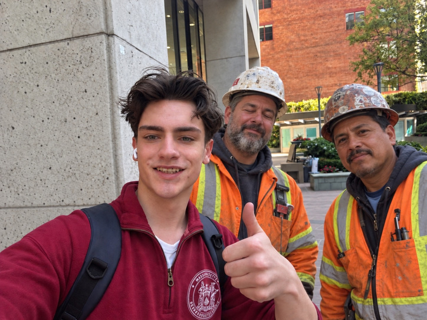
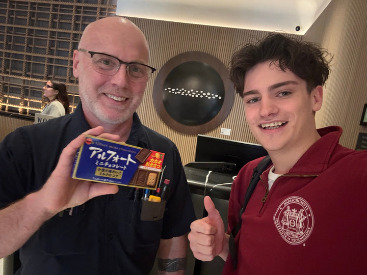
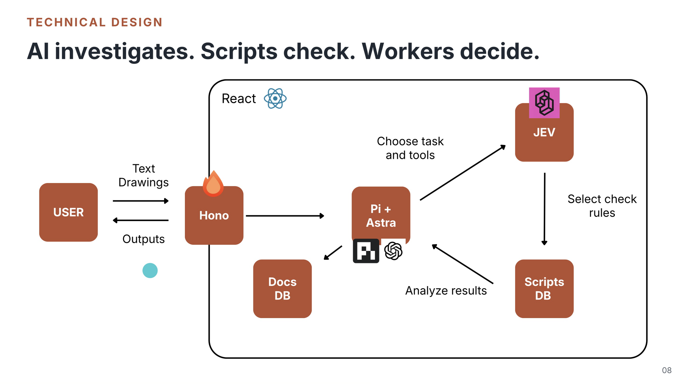

# Building Sprink: the people behind the project

I worked with Yu Yoshimuta on Sprink for the **Recruit Holdings Innovation Cup 2026**, under our team name **KumoPath**. I was a second-year student at Ritsumeikan University in Osaka, and Yu was a second-year student at Keio University in Tokyo. We were a team from Japan working on a tool for the people installing fire-sprinkler systems.

The idea was to help fitters spend less time searching for information and more time getting their work done. To understand what that should look like, we started by talking to people doing the work.

[Run the prototype](../sprink/docs/boston-setup.md) · [Watch the workflows](../README.md#see-the-workflows) · [Boston development progress](../PROGRESS.md)

## Talking with fitters in San Francisco

In the San Francisco area, I met Jack and Jose, who work as sprinkler fitters. We spoke about finding the right requirements for a job and what happens when the situation on site changes.

*With Jack and Jose during the field interviews. This photo is from our original pitch deck.*

Finding a rule was only part of the problem. The answer depended on the job, the product and the conditions in front of them. If an obstruction changed the pipe route, there was more checking to do. A useful tool needed to help someone find the original source, work out what applied and prepare the next step.

Those conversations gave us a clearer direction. We wanted the source to stay visible so the fitter could read it and check it for themselves. We also wanted the information to connect to the drawing, the materials and any changes on site.

## Learning from hotel maintenance

I also met Kareem, the chief maintenance engineer at the Hyatt Regency Hotel. That conversation gave us another perspective on the practical work of looking after a building and finding information when it is needed.

*Meeting Kareem as part of our research. The deck includes this alongside the fitter interviews that shaped the idea.*

Across those conversations, we kept coming back to three things: finding the right rule for the job, checking again when plans changed, and making the result practical enough to use. That meant sources, materials and a clear next step. We used those needs to organise the prototype.

## What we built together

We built Sprink around three workflows. Each starts with information from the worker and keeps a review step before moving forward.

### Find the original

A fitter can ask a question about a sprinkler product or installation requirement, then open the relevant original passage or PDF page. The document and page context stay available so the person reading the answer can check where it came from.

The competition prototype used manufacturer references including **Spears FlameGuard FG-3-1223** and **TYCO TFP171**. Full NFPA books were not loaded. That matters because a useful answer from one manufacturer reference does not mean the system covers every requirement for a whole installation.

[Watch the source-search demonstration](../README.md#find-the-original).

### Prepare the work

The worker starts with a drawing and confirms its scale, dimensions and other inputs. Sprink prepares a materials list, cut-length information when the necessary inputs are known, and assembly steps linked to their references. Missing information stays visible.

The package can then be reviewed and exported as PDF or CSV. Keeping those outputs connected to the saved work-package revision matters: if the inputs change, an old output should not quietly appear to be current. The repository includes the [export module and its integration notes](../sprink/docs/issue-13-exports.md), covering revision checks, source references, unresolved items and draft labels.

[Watch the materials and assembly demonstration](../README.md#prepare-the-work).

### Handle a site change

If there is an obstruction, the worker records it and the measured space around the affected pipe. Sprink generates route proposals, compares the material and length changes, and shows the checks and questions that remain open. The worker chooses a route and reviews the revised package.

This was an important connection to the field interviews. Finding a source helps with the question in front of you, but the next question may be about what has changed on site and what that means for the work already planned.

[Watch the site-change demonstration](../README.md#handle-a-site-change).

## How the software fits together

The technical idea in our pitch was **“AI investigates. Scripts check. Workers decide.”** We separated the assistant’s investigation from the explicit checks and the worker’s decision.

React and Vite provide the drawing and source views, input confirmation, proposal comparison and exports. Hono and Node.js handle the authenticated API, uploads and work-package revisions. Pi with GPT-6 Astra runs the agent workflow, while JEV supports reference retrieval and selection of checks from the rule catalog.

The verification scripts run their defined applicability, input and domain checks. They return results and missing inputs to the agent. SQLite and local files retain the work packages, confirmed facts, source metadata, observations and artifacts. When inputs change, outdated outputs are invalidated.

We wanted someone reviewing the result to be able to see what was checked and what still needed attention. Missing evidence remains `unknown`. A completed run or a passing check does not approve an installation. The [rule inventory](../sprink/docs/rule-inventory.md) sets out the implemented coverage, and the [workflow documentation](../sprink/packages/workflow/README.md) explains the agent side.

## Our first paying crew

We tested Sprink over Zoom on a Sunday morning with a Boston sprinkler fitter who had more than 27 years of experience in the trade. He bought **three monthly subscriptions at $20 each: $60 for the first month**, for himself and two members of his crew. That became our first paying crew, and we included it in our competition pitch.

Later that Sunday, we heard back that Sprink had helped him several times on a job. We now had someone who had paid for the product and was trying it during his work, which gave us something concrete to follow up on. It was **one customer buying three user subscriptions**, rather than three separate customers.

Those were our early results when we gave the pitch, rather than an update on how many subscribers we have now. We had not measured time savings yet. We still needed to understand how often the crew returned to it, which questions it handled well and where it needed improvement.

We also received an invitation to demonstrate Sprink at the next Local 550 union meeting in Boston. When we gave the competition pitch, that was one of the next steps we were planning. I am keeping it here as an invitation, rather than listing it as a demonstration we had already completed.

## What we still needed to learn

The pitch included a payback example to explain the subscription price. Using a reported baseline of about **40 crew-minutes a day** spent checking references, we modelled a **50% reduction**, **20 workdays a month** and **$60 per hour** of time value. That gives about **$400 a month** in time value, or **$340 after the $60 subscription fee**. With a 25% reduction, the model gives $140 net per month. The fee breaks even at three saved crew-minutes per workday under those assumptions.

Those were calculations to test, not savings we had measured. The model counts one worker’s time and excludes onboarding and training costs. Positive feedback from a Sunday job could not tell us whether the same results would hold across different crews and tasks.

At that point, we wanted to measure field use, improve stock lists and material exports, and explore shared crew jobs and team billing. Company plans, approval history and a possible electrician pilot came after validation. The larger market figures in the appendix were planning estimates and targets, not customers we already had.

## Continuing the work as SprinkMate

SprinkMate builds on that competition project, with the original app and Git history preserved. The later work focuses on commercial and residential sprinkler work in Boston, Massachusetts.

That work adds a browsable reference library, document-specific search, a Boston source register and reviewed state source packages. The recorded milestones include **16 reference entries**, **three importable packages with eight indexed sections**, and a local research archive of **nine government PDFs totalling 243 pages**, plus a BFD guide snapshot. The archive and the register are broader than the text that has actually been reviewed and imported.

The reference library can be read locally without an AI key. Natural-language retrieval needs a JEV key and authorised source content. Full NFPA books are not loaded, coverage is partial, and field accuracy still needs evaluation. The [progress report](../PROGRESS.md) keeps the implementation dates, verification records and remaining work together.

For me, the story starts with the people in these photos. Their questions helped us work out what to build. The next step is to keep testing whether what we built is useful in the work they actually do.

---

I have kept the two interview photos from slide 3 of our original 15-slide pitch deck alongside this account of the project. The competition details come from that deck, and the later Boston work is documented in the repository. The [media sources](media/README.md) list where each image came from.
